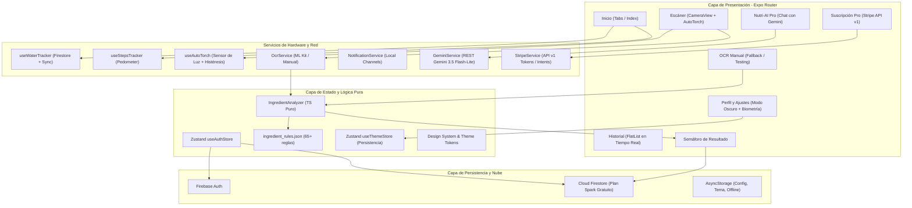
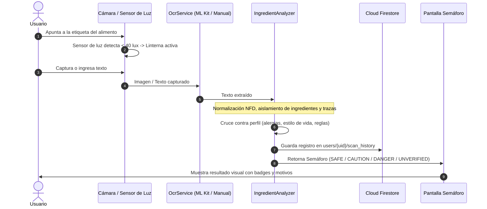

# NutriScan AI 🥗📱

> **Aplicación móvil inteligente para la seguridad alimentaria, hábitos diarios y acompañamiento nutricional con Google Gemini.**  
> Diseñada y optimizada para **Samsung Galaxy S25 Ultra (Android 15/16)** con compatibilidad total en **Expo / React Native**.

---

## 🌟 Características Principales

- **Semáforo Nutricional Inteligente**: Clasificación automática en tiempo real de alimentos en 4 niveles (**SEGURO**, **PRECAUCIÓN**, **PELIGRO**, **NO VERIFICADO**) analizando alérgenos, intolerancias y estilos de vida (vegano, vegetariano, keto, celíaco, etc.).
- **Escáner OCR de Ingredientes**: Detección de texto de etiquetas mediante **Google ML Kit** en desarrollo nativo y modo asistido manual con presets para pruebas rápidas.
- **Sensor de Luz con Histéresis**: Detección automática de baja luminosidad ambiental (< 40 lux) con encendido inteligente de linterna y apagado automático al salir de la vista.
- **Nutri-AI Pro (Google Gemini 3.5 Flash-Lite)**: Asistente clínico y nutricional con instrucciones de sistema personalizadas que se adaptan al perfil de salud del usuario, sus alergias y sus escaneos recientes.
- **Pasarela de Suscripción Stripe**: Arquitectura cliente compatible con el estándar **PCI-DSS** sobre la API REST v1 de Stripe (`/v1/tokens` y `/v1/payment_intents`), con tokenización y emisión de recibos en modo prueba.
- **Modo Oscuro Dinámico y Persistente**: Paleta de alto contraste optimizada para pantallas AMOLED con negros profundos y persistencia automática en `AsyncStorage`.
- **Rastreador de Hidratación Inteligente**: Registro de agua en tiempo real con distribución equitativa de vasos a lo largo del día y restricción de alertas nocturnas (11:00 PM a 6:00 AM).
- **Rastreador de Pasos (Pedometer)**: Conteo y cálculo de progreso diario hacia la meta del usuario.
- **Sincronización con Firebase**: Autenticación persistente (con modo invitado anónimo y cuenta permanente) y almacenamiento en **Cloud Firestore**.
- **Android 15 Edge-to-Edge Ready**: Integración con `react-native-safe-area-context` para respetar status bars, cámaras punch-hole y barras de navegación del Galaxy S25 Ultra.

---

## 🏗️ Arquitectura del Sistema

El proyecto sigue una arquitectura limpia desacoplada (**Clean Architecture + Mobile-First**):



---

## 📋 Flujo de Escaneo y Clasificación



---

## 🔒 Seguridad y Manejo de Información Sensible

Este repositorio aplica una política estricta de **cero fuga de credenciales**:
- El archivo `.env` está expresamente excluido en `.gitignore`.
- Las llaves secretas nunca se suben al repositorio.
- Se proporciona `.env.example` como plantilla para configurar tus credenciales personales.
- Las llamadas a Stripe usan una clave pública de prueba y tokenización conforme a PCI-DSS sin almacenamiento de números de tarjeta en texto plano.

---

## 🚀 Requisitos e Instalación

### 1. Requisitos Previos
- **Node.js**: v18.0.0 o superior (recomendado Node 20 LTS o 22).
- **npm** o **bun** instalado.
- Dispositivo Android con depuración USB activada (o emulador con Android 14+).

### 2. Clonar el Repositorio e Instalar Dependencias
```bash
git clone https://github.com/LovableRelic000/NutriScan.git
cd NutriScan
npm install
```

### 3. Configurar Variables de Entorno
Copia el archivo de plantilla a `.env`:
```bash
cp .env.example .env
```

Edita `.env` con tus credenciales:
```env
# Firebase Web App Configuration (Spark Plan - Free)
EXPO_PUBLIC_FIREBASE_API_KEY=tu_api_key_aqui
EXPO_PUBLIC_FIREBASE_AUTH_DOMAIN=tu_proyecto.firebaseapp.com
EXPO_PUBLIC_FIREBASE_PROJECT_ID=tu_proyecto
EXPO_PUBLIC_FIREBASE_STORAGE_BUCKET=tu_proyecto.firebasestorage.app
EXPO_PUBLIC_FIREBASE_MESSAGING_SENDER_ID=tu_messaging_sender_id
EXPO_PUBLIC_FIREBASE_APP_ID=tu_app_id

# Google Gemini API Key (Gratis en https://aistudio.google.com/app/apikey)
EXPO_PUBLIC_GEMINI_API_KEY=tu_gemini_api_key_aqui
```

---

## 📱 Modos de Ejecución

### Modo A: Expo Go (Rápido y multiplataforma)
Ideal para probar UI, navegación, chat de IA, perfil de salud, hidratación y el analizador de ingredientes:
```bash
npx expo start
```
Escanea el código QR desde la app **Expo Go** en tu dispositivo.  
*(Nota: Para probar el análisis de ingredientes en Expo Go, utiliza la pantalla **OCR Manual** con los presets incluidos).*

### Modo B: Development Build Nativo (ML Kit OCR en vivo)
Para compilar y ejecutar con el módulo nativo de reconocimiento de texto en un dispositivo físico conectado por USB:
```bash
# 1. Verifica la conexión con ADB
adb devices

# 2. Compila e instala en el dispositivo Android
npx expo run:android
```

---

## 🧪 Pruebas Automatizadas y Calidad de Código

El proyecto cuenta con validación continua de tipos, pruebas unitarias y diagnóstico de dependencias:

```bash
# 1. Verificación de tipos TypeScript
npx tsc --noEmit

# 2. Ejecución de pruebas unitarias (Jest)
npm test

# 3. Diagnóstico de configuración Expo
npx expo-doctor
```

Estado de pruebas: **21/21 pruebas unitarias pasando al 100%**.

---

## 📂 Estructura del Proyecto

```
NutriScan/
├── assets/                  # Iconos, fuentes y reglas de ingredientes JSON
├── src/
│   ├── app/                 # Rutas y pantallas (Expo Router)
│   │   ├── (tabs)/          # Barra de navegación principal (Home, Scanner, Chat, History, Profile)
│   │   ├── auth.tsx         # Inicio de sesión / Creación de cuenta / Modo Invitado
│   │   ├── onboarding.tsx   # Selección inicial de alergias y estilos de vida
│   │   ├── scan-result.tsx  # Pantalla de detalle del semáforo nutricional
│   │   ├── manual-ocr.tsx   # Analizador manual de ingredientes
│   │   └── subscription.tsx # Pasarela de suscripción Pro (Stripe API v1)
│   ├── components/ui/       # Componentes reutilizables (Badge, Button, Card, Chip, ProgressRing)
│   ├── core/                # Configuración, tokens de diseño y tema dinámico
│   ├── data/                # Repositorios y modelos de datos (Firestore / ScanRepository)
│   ├── features/auth/       # Store de autenticación con Zustand
│   └── services/            # Servicios de integración
│       ├── analyzer/        # Motor de análisis de ingredientes y alérgenos
│       ├── gemini/          # Asistente Nutri-AI Pro con Gemini 3.5 Flash-Lite
│       ├── hydration/       # Monitoreo de agua y cálculo de recordatorios
│       ├── notifications/   # Canales de notificación locales de Android
│       ├── ocr/             # Reconocimiento de texto con ML Kit
│       ├── sensors/         # Sensor de luz ambiental con histéresis
│       ├── steps/           # Podómetro y actividad física
│       └── stripe/          # Integración cliente con API de Stripe
├── .env.example             # Plantilla de variables de entorno segura
├── firestore.rules          # Reglas de seguridad declarativas de Firestore
└── package.json             # Dependencias del proyecto Expo SDK 57
```

---

## 📄 Licencia

Proyecto desarrollado con fines académicos y de investigación en salud digital y bienestar nutricional.
